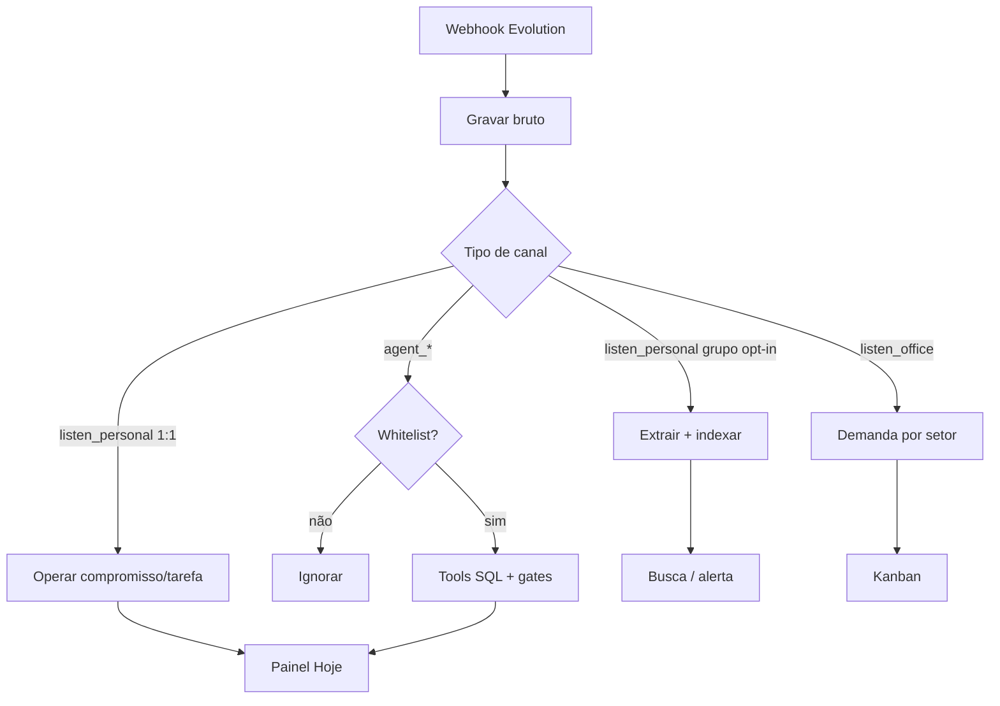
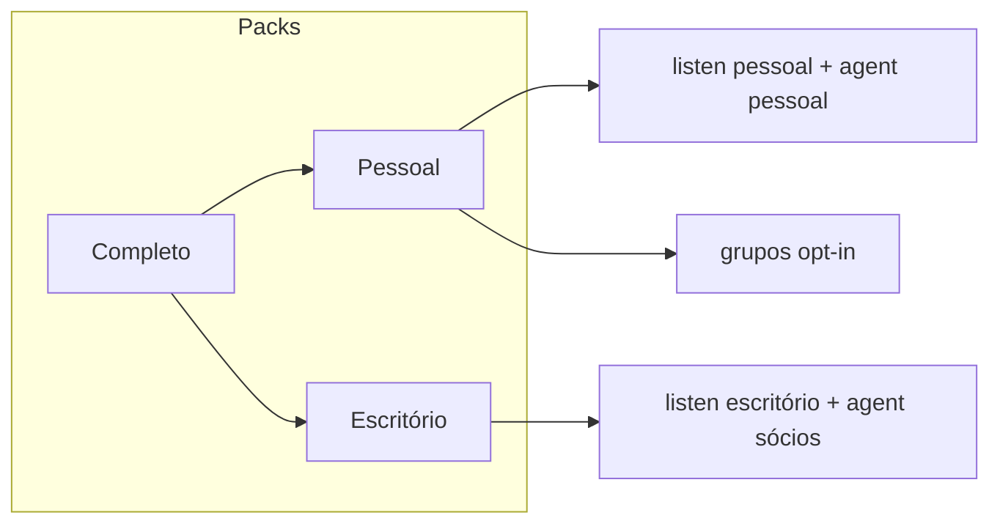

# Fluxo do App — Prumo

> Como o usuário se move pelo produto.
> Fonte: [x] Entrevista com usuário  [x] Brief unificado
> Depende de: [PRD](PRD.md)

**Data**: 2026-10-28

## 1. Perfis de usuário

| Perfil | Modo | Permissões principais |
|---|---|---|
| Dono / chefe | Pessoal | Tudo do escopo pessoal; comanda o agente pessoal; liga grupos opt-in |
| Admin do tenant | Ambos | Canais, usuários, modos ligados, diagnóstico |
| Sócio | Escritório (fase 2) | Vê tudo do escritório; recebe agente escritório |
| Gestor de setor | Escritório (fase 2) | Quadro e demandas do setor |
| Colaborador | Escritório (fase 2) | O que é seu |
| Contato externo | — | Não usa o app; só é ouvido |

No MVP (modo Pessoal): na prática **Dono** + **Admin** (pode ser a mesma pessoa).

## 2. Jornadas principais

### Jornada 1: Ligar o modo Pessoal

Perfil: Admin / Dono

1. Cria conta / entra no painel.
2. Ativa pack Pessoal.
3. Conecta **escuta pessoal** (instância Evolution + QR) e **agente pessoal** (outra instância/número).
4. Cadastra whitelist (próprio número).
5. Sistema confirma canais saudáveis no Diagnóstico.

Telas: Onboarding · Canais · Diagnóstico  
Erro: Evolution fora → faixa de alerta; não marca canal como ativo.

### Jornada 2: Conversas 1:1 viram agenda/tarefas (e atualizam)

Perfil: sistema (+ Dono confere)

1. Mensagem chega na escuta pessoal.
2. Grava bruto (idempotente).
3. Job: regras → (se preciso) LLM com contexto curto → cria **ou atualiza** compromisso/tarefa.
4. Na dúvida, marca “confirmar”; Dono confirma no painel ou pelo agente.
5. Remarque / conclusão pelo painel ou WhatsApp do agente → estado SQL muda; Hoje reflete.

Telas: Hoje · Agenda · Tarefas · (opcional) Inbox  
Erro: falha de LLM → item fica pendente de classificação; mensagem bruta preservada.

### Jornada 3: Falar com o agente pessoal

Perfil: Dono (whitelist)

1. Escreve no número do agente (“o que tenho hoje?”, “remarca X para amanhã 15h”, “conclui Y”).
2. Sistema autentica remetente; se não está na whitelist, ignora.
3. Orquestrador usa tools sobre SQL (não reprocessa o WhatsApp inteiro).
4. Resposta curta; gates impedem inventar telefone/link/número.

Telas: nenhuma obrigatória (WhatsApp); espelho no painel  
Erro: tool falha → diz que não conseguiu; não inventa.

### Jornada 4: Grupo opt-in (ponto cego)

Perfil: Dono

1. Em Grupos, marca “acompanhar” em um grupo (default off).
2. Mensagens gravam; extratores geram itens; janelas indexam sem chat LLM.
3. Dono pergunta ao agente: “onde está o endereço que fulano mandou no grupo X?”
4. Busca híbrida; resposta cita origem (grupo, autor, data).

Telas: Grupos · (resultado via agente ou Busca)  
Erro: grupo não acompanhado → “não estou ouvindo esse grupo”.

### Jornada 5 (fase 2): Modo Escritório

Perfil: Admin / Sócio

1. Liga pack Escritório; conecta escuta da empresa + agente dos sócios.
2. Mensagens viram demandas por setor (regras + IA) **com** capacidade de mover/atualizar.
3. Sócios recebem resumo/alerta no agente; equipe usa Kanban por papel.

Telas: Canais · Setores · Quadro · Painel executivo  
Erro: mesmo padrão de canal caído.

## 3. Diagramas

---

## Princípios de fluxo

1. Escuta nunca envia; agente nunca é o número do cliente/escritório.
2. Confirmar na dúvida &gt; compromisso falso.
3. Grupo: silêncio por padrão; valor na busca/alerta, não no spam.
